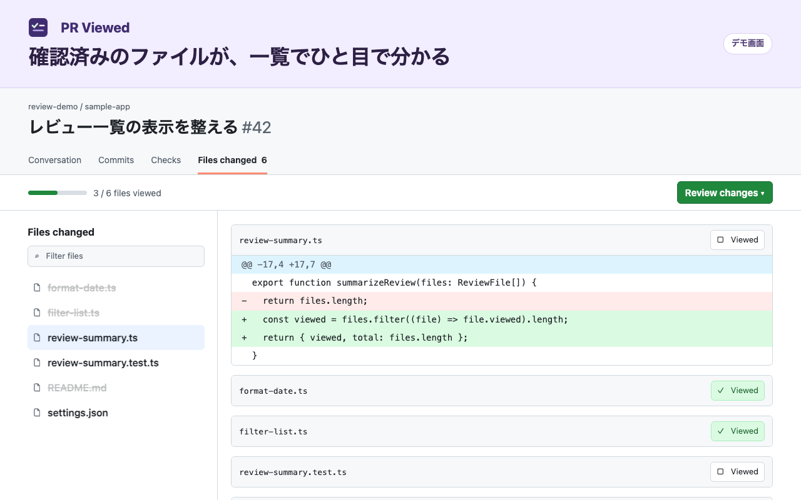

# PR Viewed

GitHub のプルリクエストで、確認済みのファイルを左の一覧から見分けやすくする Chrome 拡張機能です。

差分画面で `Viewed` にチェックを入れると、左の変更ファイル一覧で、対応するファイル名が薄くなり、打ち消し線が付きます。確認済みのファイルも一覧から開き直せます。チェックを外すと表示は元に戻ります。

## 動作イメージ

模擬 PR に拡張機能を適用した画面です。

## インストール

Chrome 102 以降で動作します。

1. このリポジトリをダウンロードし、ZIP の場合は解凍します。
2. Chrome のアドレスバーで `chrome://extensions` を開き、「デベロッパー モード」をオンにします。
3. 「パッケージ化されていない拡張機能を読み込む」を押し、`manifest.json` が入っているフォルダを選びます。
4. GitHub のプルリクエストで **Files changed** または **Changes** を開きます。インストール前から開いている GitHub のタブは、一度再読み込みしてください。

## 対象とデータの取り扱い

対象は `github.com` の PR 差分画面です。大きな PR や差分を1件ずつ表示する画面では、各ファイルの差分が読み込まれたときに、その確認状態が一覧へ反映されます。

拡張は GitHub 内のページ移動を検知し、差分画面にいるときだけ `Viewed` の状態と差分リンクを読み取ります。処理はブラウザ内で行い、外部送信、永続保存、アクセス解析は行いません。

開発・公開者は白藤杏奈です。PR Viewed は GitHub 向けの独立した拡張機能です。
